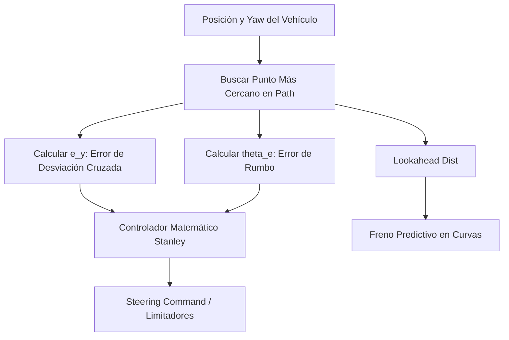

# Arquitectura de Navegación F1: Planificador A* y Rastreador Stanley

Este informe detalla minuciosamente la arquitectura técnica implementada en el vehículo para su navegación autónoma en modo carrera (F1). Combina la visión macro de los subsistemas con un análisis profundo del código, las variables y las matemáticas en tres pilares fundamentales: Planificación Global (A*), Seguimiento Local (Stanley) y Evasión Reactiva de Obstáculos (AEB).

---

## 1. Sistema de Planificación Global (A*) y Lógica F1

El planificador global (`astar_planner.py`) tiene la responsabilidad de trazar la **línea de carrera (racing line)** óptima a través del mapa estático (`/map`), asegurando que el vehículo siempre avance hacia adelante sin tomar atajos inválidos ni devolverse.

### 1.1 El Bloqueo Dinámico (Muro de Guillotina)
Uno de los mayores retos del modo carrera en un circuito cerrado es evitar que el algoritmo A* optimice la ruta devolviéndose por la misma recta de salida. Para solucionarlo, se implementó la lógica de la **Guillotina**. 

Al recibir el comando de iniciar vueltas (`/laps_cmd`), el planificador proyecta la meta **fija** unos metros más adelante de la recta principal. Inmediatamente, lee la posición del robot y crea un muro de ladrillos virtual detrás de él.

**Deep-Dive de Código (La Matemática de la Guillotina):**
Cuando se llama a `plan_path()`, se extrae y guarda la pose actual como el punto de anclaje de la guillotina:
```python
rx, ry, ryaw = self.get_robot_pose()
self.dynamic_wall = (rx, ry, ryaw) # Guardado como estado
```

Durante la expansión de nodos del A*, la función `is_valid_small(x, y)` intercepta las coordenadas candidatas y les aplica una matriz de rotación paramétrica inversa `-ryaw`. Esto transforma el espacio global del mapa a la perspectiva local del coche (donde $+X$ es el frente y $-X$ es la espalda):
```python
# Convertir coordenadas del mapa a coordenadas locales del robot
dx = wx - rx
dy = wy - ry
local_x = dx * math.cos(-ryaw) - dy * math.sin(-ryaw)
local_y = dx * math.sin(-ryaw) + dy * math.cos(-ryaw)

# Bloqueo estricto: Todo lo que esté entre 0.5m y 2.5m DETRÁS del robot (-local_x),
# con un ancho de 8 metros (-4 a +4 en y_local) es declarado INVÁLIDO.
if -2.5 <= local_x <= -0.5 and -4.0 <= local_y <= 4.0:
    return False
```
**Efecto:** El A* queda matemáticamente "acorralado" y se ve forzado a calcular la ruta hacia adelante, trazando todo el bucle de 100m para llegar a la meta.

### 1.2 Congelamiento del Recálculo Dinámico
El A* habitualmente utiliza un `timer` para recalcular su ruta. Sin embargo, para la Lógica F1, este *timer* fue **desactivado**.
**La Paradoja del Bucle:** Si el A* recalculaba a mitad de pista, generaba un segmento abierto en lugar de un bucle cerrado. Al llegar a la meta, el rastreador intentaba unir ese corte brusco, cruzando paredes a 10 m/s.
```python
def plan_timer_callback(self):
    pass # Disabled for F1 Racing Mode
```
**Solución:** La línea se traza de forma inmaculada UNA sola vez. El coche corre repitiendo este bucle geométrico "de memoria", garantizando empalmes predecibles y perfectos.

---

## 2. Rastreador Local: Controlador Stanley

El componente `mppi_tracker.py` fue reescrito para utilizar el algoritmo de control **Stanley**, operando a $100\text{ Hz}$ (`self.dt = 0.01s`). Este controlador es el estándar de oro en la industria robótica para mantener la estabilidad de vehículos Ackermann a altas velocidades.



### 2.1 Ecuación de Stanley y Errores
La dirección se calcula fusionando dos errores medidos desde el eje delantero:

1. **Error de Rumbo (`theta_e`):** Mantiene el coche paralelo a la pista.
2. **Error Cruzado (`e_y`):** Distancia ortogonal corregida mediante producto cruz (para distinguir izquierda/derecha).

**Deep-Dive de Código:**
```python
# Proyectar el eje hacia el tren delantero
fx = rx + L * math.cos(ryaw)
fy = ry + L * math.sin(ryaw)

# Error Cruzado (e_y) usando producto cruz vectorial
cross_prod = (px_next - px) * (fy - py) - (py_next - py) * (fx - px)
e_y = math.copysign(dists[closest_idx], cross_prod)

# Error de Rumbo (theta_e) normalizado entre -pi y pi
theta_e = path_yaw - ryaw
theta_e = math.atan2(math.sin(theta_e), math.cos(theta_e)) 

# Ecuación de Control Stanley
stanley_steer = theta_e + math.atan2(-k_stanley * e_y, abs(self.current_vel) + k_soft)
```
**Variables Clave:**
* `k_stanley = 6.0`: Ganancia agresiva. Corrige la trazada fuertemente a altas velocidades.
* `k_soft`: Parámetro estabilizador para que la tangente no se dispare a infinito a velocidades cercanas a cero.

### 2.2 Freno Ortogonal (Anti-Orbiting) y Modulación Predictiva
En curvas cerradas a 10.5 m/s, el coche sufre subviraje. El sistema usa un "Lookahead" paramétrico (`future_yaw`) para predecir curvas cerradas y hundir el freno simulado ANTES de derrapar.

**Deep-Dive de Código:**
```python
future_yaw = # Yaw de un punto situado a "lookahead_dist" metros adelante.
yaw_diff = abs(math.atan2(math.sin(future_yaw - ryaw), math.cos(future_yaw - ryaw)))

# Si la diferencia angular a futuro supera ~20 grados, el speed factor colapsa
speed_factor = max(0.0, 1.0 - (yaw_diff / 0.35))
target_vel = min_v + speed_factor * (max_v - min_v)
```
Esto reduce la velocidad a la mínima (`min_v = 2.5 m/s`) al entrar a la curva, y la dispara a la máxima (`max_v = 10.5 m/s`) en recta.

### 2.3 Transición Continua (Lap Counting)
El rastreador empalma el fin con el inicio (cerrando el bucle) mediante una interpolación spline. Luego, detecta el cruce de meta observando el índice de seguimiento.
```python
# Si el índice salta bruscamente del final (99%) de vuelta al inicio (1%):
if closest_idx < 50 and self.prev_closest_idx > len(self.global_path) - 50:
    if self.laps_remaining > 0:
        self.laps_remaining -= 1
        self.lap_comp_pub.publish(msg) # Dispara evento vacío
```
Mientras las vueltas no lleguen a 0, ignora la meta matemáticamente asignando `dist_to_goal = 999.0` para no frenar jamás durante la carrera.

---

## 3. Integración del AEB y Evasión Reactiva

Al haber apagado el recálculo dinámico en el planificador global (A*), el coche depende 100% de sus reflejos locales para esquivar conos y detenerse automáticamente.

### 3.1 Campo de Potencial Repulsivo (Virtual Force)
El tracker suscribe al LiDAR (`/scan`) y aísla el obstáculo frontal más cercano dentro de un cono de visión ajustado ($\pm 28^\circ$). Si se viola la burbuja de seguridad, inyecta una **fuerza electromagnética matemática** al timón.

**Deep-Dive de Código:**
```python
# Si un cono invade el radio de repulsión (ej. 1.0 m)
if self.closest_obstacle_dist < repulsion_radius:
    repulsion = (repulsion_radius - self.closest_obstacle_dist) * repulsion_gain
    
    # Inyectar fuerza opuesta directamente al timón de Stanley
    if self.closest_obstacle_angle > 0: 
        stanley_steer -= repulsion      
    else:                               
        stanley_steer += repulsion      
```
Este sistema tiene latencia nula; a 10 m/s empuja el coche violentamente fuera del cono, anulando temporalmente la línea de carrera ideal hasta que el peligro desaparece.

### 3.2 Lógica de Detención y AEB (Emergency Braking)
Cuando el evento de Lap Counting decreta que `laps_remaining == 0`, el sistema vuelve a encender la percepción de meta (`dist_to_goal`). Si cruza físicamente la línea, se activa el `stop_vehicle()`.

**Deep-Dive de Código:**
```python
def stop_vehicle(self):
    decel = self.get_parameter('max_deceleration').value
    self.cmd_v_prev = max(0.0, self.cmd_v_prev - decel * self.dt)
```
Esta función rompe la inercia restando progresivamente `decel * dt` a la velocidad deseada en cada ciclo de procesador. El coche frena deslizando suavemente y el sistema imprime: `"Carrera Finalizada. Estacionamiento preciso completado."`
